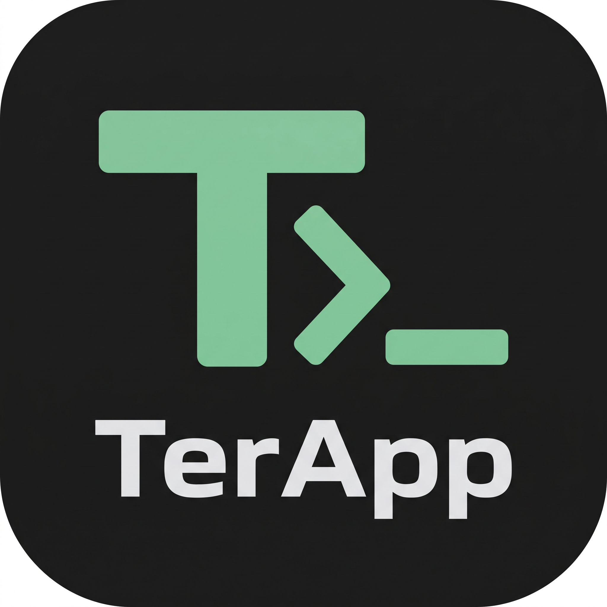

<p align="center">
  
</p>

# TerApp 🦀

> An ultra-low memory, high-performance terminal emulator and Linux environment for Android, rewritten in **Rust**.

[](https://www.rust-lang.org/)
[](LICENSE)
[]()

---

## 💡 Inspiration & Acknowledgements

**TerApp** is deeply inspired by [**Termux (`termux/termux-app`)**](https://github.com/termux/termux-app). 

Termux revolutionized running Linux software on mobile devices without requiring root access. However, as mobile workflows have expanded, the underlying Android Java/Kotlin runtime (ART) overhead, object allocation pressure, and large package databases often result in noticeable memory consumption (often 80MB–200MB+ of RAM during active sessions).

**TerApp** takes the concepts pioneered by the Termux team and rebuilds them from the ground up using **Rust** and zero-overhead native systems design, focusing on:
* **Minimal Memory Footprint (Sub-15MB target total app RAM)**
* **Zero Garbage Collection (GC) pauses**
* **Instant cold startup**
* **Pre-allocated, cache-friendly data structures**

---

## ⚡ Tech Stack & Architecture Highlights

| Layer | Traditional Termux | TerApp (Our Rust Remake) | Advantage |
| :--- | :--- | :--- | :--- |
| **Language** | Java & Kotlin | **Rust (100% Native)** | Zero-cost abstractions, thread safety, no JVM/ART overhead. |
| **Terminal Core** | Java Terminal Emulator | **`terapp-core` (Zero-dep Rust)** | Raw byte stream parsing with 0 dynamic allocations during execution. |
| **Screen Buffer** | Java Objects & Text Layout | **Bit-packed `Cell` & Ring Buffer** | ~9.38 KB active screen grid; eliminates heap fragmentation. |
| **Scrollback** | Dynamic ArrayList / Deque | **Circular Fixed-Capacity Buffer** | O(1) recycling of scrolled lines without re-allocations. |
| **PTY Layer** | Android NDK C Wrapper | **`terapp-pty` (Safe POSIX Rust)** | Direct Linux kernel `/dev/pts` pseudo-terminal interaction. |
| **Android Bridge** | Native JNI layer | **`terapp-android` (`libterapp.so`)** | Thread-safe Rust JNI bridge with lock-free rendering pipelines. |
| **Userland** | GNU Coreutils + Debian APT | **BusyBox / Toybox + Alpine APK** | Drastically reduced disk and RAM footprint. |

---

## 📊 Live Memory Benchmark (Release Build)

| Metric | Measurement |
| :--- | :--- |
| **Cell Struct Size** | `16 bytes` (Character + Bitflags + ANSI/RGB Color) |
| **Active Screen Memory (80x24)** | **~30.7 KB** |
| **Scrollback Memory (1,000 lines)** | **~1.28 MB** (pre-allocated ring buffer) |
| **Core Binary Footprint** | **~270 KB** (stripped, LTO enabled, `opt-level = "z"`) |

---

## 📂 Project Structure

This project is organized as a Cargo workspace:

```text
TerApp/
├── Cargo.toml                  # Workspace root & release profile configuration
├── README.md                   # Project documentation & roadmap
└── crates/
    ├── terapp-core/            # 100% dependency-free VT100 / ANSI terminal engine
    │   ├── src/cell.rs         # Compact cell & color representations
    │   ├── src/buffer.rs       # Circular ring buffer & screen grid
    │   ├── src/parser.rs       # ANSI escape sequence state machine & UTF-8 decoder
    │   └── src/lib.rs
    ├── terapp-pty/             # POSIX pseudo-terminal (PTY) spawner
    │   └── src/lib.rs          # Cross-platform PTY abstraction & Unix /dev/pts
    ├── terapp-cli/             # Interactive desktop test harness (Windows/Linux/macOS)
    │   └── src/main.rs         # Raw-mode terminal UI with live system commands
    └── terapp-android/         # Android JNI shared library (libterapp.so)
        └── src/lib.rs          # JNI bindings for Android Activity / SurfaceView
```

---

## 🛠️ Getting Started (Desktop Testing)

You can build and test the terminal engine directly on your development machine before deploying to Android.

### Prerequisites
* [Rust](https://www.rust-lang.org/) (Cargo 1.85+)
* Git

### Build & Run
```bash
# Clone the repository
git clone https://github.com/<your-username>/terapp.git
cd terapp

# Build all crates with release optimizations
cargo build --release

# Launch the interactive terminal runner
./target/release/terapp-cli
```

### Interactive Built-in Commands
Once inside the `terapp:~$` prompt:
* `mem` — Inspect live RAM memory usage of the screen and scrollback buffer.
* `colors` — Display the 16-color ANSI rendering palette.
* `scroll` — Benchmark the 30-line ring buffer scrolling speed.
* `clear` — Clear the screen.
* Standard OS commands (`ls`, `dir`, `ping`, `echo`, etc.) are piped through the engine.
* `exit` or `Ctrl + C` — Exit.

---

## 🗺️ Development Roadmap (Aligning with `termux-app`)

Development references the architectural milestones of [`termux/termux-app`](https://github.com/termux/termux-app):

- [x] **Milestone 1: Core Terminal Engine & Parser**
  - [x] Bit-packed terminal cell design
  - [x] ANSI/VT100 CSI state machine (Cursor, SGR colors, line/screen erase)
  - [x] Circular ring buffer for zero-fragmentation scrollback
  - [x] Interactive PC test harness (`terapp-cli`)
- [ ] **Milestone 2: Android Host & IME Keyboard Bridge**
  - [x] JNI shared library bridge (`terapp-android`)
  - [ ] Ultra-lightweight Android host Activity
  - [ ] SurfaceView / ANativeWindow hardware-accelerated text renderer
  - [ ] Android Soft Keyboard (IME) input & extra keys bar (Ctrl, Alt, Esc, Tab)
- [ ] **Milestone 3: Linux PTY & Process Management**
  - [ ] Android POSIX PTY `/dev/pts` session spawner
  - [ ] Signal handling (`SIGWINCH`, `SIGINT`, `SIGHUP`)
  - [ ] Background daemon / service management
- [ ] **Milestone 4: Minimalist Userland Integration**
  - [ ] Pre-compiled BusyBox bootstrap for ARM64 & x86_64
  - [ ] Alpine APK or OPKG lightweight package management integration
- [ ] **Milestone 5: Open-Source Community & Extensions**
  - [ ] CI/CD automated APK cross-compilation pipeline
  - [ ] Plugin architecture (API, Widget, Boot support)

---

## 🤝 Contributing

Contributions are very welcome! Whether you are interested in:
* Optimizing the VT100 parser in `terapp-core`
* Implementing the Android `ANativeWindow` renderer
* Packaging BusyBox bootstrap scripts

Feel free to fork the repository, open an issue, or submit a Pull Request.

---

## 📜 License

This project is licensed under either of:
* Apache License, Version 2.0 ([LICENSE-APACHE](LICENSE-APACHE))
* MIT License ([LICENSE-MIT](LICENSE-MIT))

at your option.

Special thanks to the [Termux Project](https://github.com/termux) for showing what is possible on Android!
